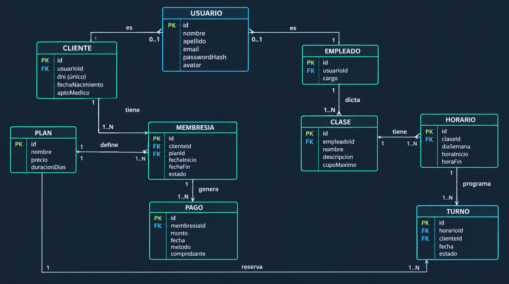

# Gimnasio - Trabajo Final Laboratorio II

Sitio web para administrar un gimnasio, hecho con ASP.NET Core MVC. Permite gestionar usuarios, clientes, empleados, planes, membresías, pagos, clases, horarios y turnos, y controlar el ingreso de los clientes al local por DNI.

## Tecnologías

- ASP.NET Core MVC (.NET 10)
- Entity Framework Core con MariaDB/MySQL (paquete Microting.EntityFrameworkCore.MySql)
- ASP.NET Core Identity para login, usuarios y roles
- Vue.js (archivo local en `wwwroot/lib/vue`) para el ABM de clases
- JWT (paquete Microsoft.AspNetCore.Authentication.JwtBearer) para la API

## Modelo de datos

Entidades propias:

- **Cliente**: datos propios del cliente (DNI, fecha de nacimiento, apto médico). Se relaciona 1 a 1 con un usuario. El DNI es único.
- **Empleado**: datos propios del empleado (cargo). Se relaciona 1 a 1 con un usuario.
- **Plan**: planes de suscripción (nombre, precio, duración en días).
- **Membresía**: un cliente tiene un plan durante un período, con su estado. La fecha de fin se calcula sola sumando la duración del plan a la fecha de inicio.
- **Pago**: cada membresía genera pagos (monto, fecha, método, comprobante).
- **Clase**: clase que dicta un empleado, con cupo máximo.
- **Horario**: días y horas en que se dicta cada clase.
- **Turno**: reserva de un cliente a un horario en una fecha.

Las tablas que empiezan con `AspNet` las crea Identity. `AspNetUsers` es nuestra clase Usuario (con nombre, apellido y avatar), `AspNetRoles` guarda los roles y `AspNetUserRoles` guarda qué rol tiene cada usuario.

Un cliente no puede reservar dos veces el mismo horario en la misma fecha: hay un índice único en Turnos (`HorarioId`, `ClienteId`, `Fecha`).

Al eliminar un usuario empleado se elimina también su registro de Empleado y, en cascada, sus clases y los horarios de esas clases. Al eliminar una clase se eliminan también sus horarios.

### Diagrama entidad-relación
El siguiente diagrama representa las entidades principales de la base de datos del sistema Gimnasio y sus relaciones.


## Estructura del proyecto

- **Controllers/**: CuentaController (login y logout), UsuarioController (ABMC de usuarios con paginado, avatar, DNI y apto médico), PlanController (ABMC de planes), ClaseController (ABM de clases con Vue.js y búsqueda AJAX de entrenador), HorarioController (ABMC de horarios), MembresiaController (ABMC de membresías con búsqueda AJAX de cliente), PagoController (ABMC de pagos con comprobante y búsqueda AJAX de membresía), TurnoController (inscripción de clientes a clases), IngresoController (ingreso de clientes por DNI), ApiLoginController y ApiPlanesController (API con JWT) y HomeController.
- **Services/ServicioArchivos.cs**: guarda y borra los archivos subidos (avatares, aptos médicos y comprobantes de pago).
- **wwwroot/uploads/**: carpeta donde se guardan los archivos subidos. Se crea sola y no se sube al repositorio.
- **wwwroot/lib/vue/**: archivo local de Vue.js.
- **Data/ContextoDatos.cs**: conecta las clases con la base de datos y define reglas de las tablas.
- **Data/SemillaDatos.cs**: al arrancar la app crea los roles y el usuario administrador si no existen.
- **Models/**: las clases de las entidades, los enums (EstadoMembresia, EstadoTurno, MetodoPago) y los roles (Roles.cs).
- **Models/ViewModels/**: modelos usados en las vistas (UsuarioViewModel, ClaseViewModel, HorarioViewModel, MembresiaViewModel, PagoViewModel e IngresoViewModel).
- **Views/**: vistas simples.
- **BaseDatos/gimnasio.sql**: exportación de la base de datos.
- **Program.cs**: configuración de la app (base de datos, Identity, cookies de login, JWT, archivos estáticos).
- **Postman/**: colección de Postman con los pedidos de la API.

## Cómo correr el proyecto

### Requisitos

- .NET 10 SDK
- MariaDB o MySQL
- Git

El proyecto puede ejecutarse tanto en **Windows como en Linux**.

### 1. Clonar el repositorio

```bash
git clone <URL_DEL_REPOSITORIO>
cd Trabajo-Final-Lab-II
```

### 2. Crear la base de datos

Primero hay que tener el servidor de MariaDB/MySQL instalado y ejecutándose.

Luego, crear la base de datos y el usuario.

**Linux:**

```bash
sudo mariadb
```

**Windows:**

Abrir la consola de MariaDB/MySQL y ejecutar el siguiente SQL:

```sql
CREATE DATABASE gimnasio CHARACTER SET utf8mb4 COLLATE utf8mb4_unicode_ci;
CREATE USER 'gimnasio'@'localhost' IDENTIFIED BY 'gimnasio123';
GRANT ALL PRIVILEGES ON gimnasio.* TO 'gimnasio'@'localhost';
FLUSH PRIVILEGES;
```

En caso de utilizar un usuario de MariaDB/MySQL diferente, adaptar el connection string de `appsettings.json`.

### 3. Cargar las tablas

El proyecto incluye una exportación de la base de datos en:

```text
BaseDatos/gimnasio.sql
```

**Linux:**

```bash
sudo mariadb gimnasio < BaseDatos/gimnasio.sql
```

**Windows:**

Se puede importar el archivo `BaseDatos/gimnasio.sql` desde MySQL Workbench, phpMyAdmin o la consola de MariaDB/MySQL.

Si la base ya estaba creada antes de agregar el DNI de los clientes, hay que agregar la columna a mano:

```sql
ALTER TABLE Clientes ADD COLUMN Dni varchar(9) NULL;
ALTER TABLE Clientes ADD UNIQUE KEY IX_Clientes_Dni (Dni);
```

### 4. Revisar la conexión

Verificar que el connection string de `appsettings.json` coincida con el usuario, contraseña, servidor y base de datos configurados.

### 5. Ejecutar la aplicación

Desde la raíz del repositorio:

```bash
dotnet run
```

La aplicación mostrará en la terminal la dirección local donde está disponible.

### 6. Iniciar sesión

Abrir la dirección indicada por la terminal y entrar a:

```text
/Cuenta/Login
```

## Usuario de prueba

Al arrancar, el seeder crea los roles Administrador, Recepcionista, Entrenador, Nutricionista, Administrativo y Cliente, y este usuario:

- Rol: Administrador
- Email: admin@gimnasio.com
- Contraseña: Admin123

## Seguridad

- El login usa Identity con cookies. Si alguien intenta acceder sin iniciar sesión, se lo redirige a `/Cuenta/Login`.
- `UsuarioController`, `PlanController`, `ClaseController` y `HorarioController` solo pueden ser utilizados por el rol Administrador.
- `MembresiaController`, `PagoController`, `TurnoController` e `IngresoController` pueden ser utilizados por los roles Administrador y Recepcionista.
- Quien esté logueado sin el rol necesario verá la pantalla de acceso denegado.
- Las contraseñas se guardan hasheadas con Identity.
- La API usa tokens JWT (ver la sección "API con JWT").

## Roles y permisos

El sistema define seis roles. En esta versión la operación diaria la hacen el Administrador y el Recepcionista, y los otros roles quedaron creados para futuras ampliaciones.

| Rol | Que hace uno |

| Administrador | Todo: usuarios, planes, clases, horarios, membresias, pagos, turnos e ingreso de clientes por DNI. |
| Recepcionista | Membresías, pagos, turnos e ingreso de clientes por DNI. |
| Entrenador | Figura como responsable de las clases: el Administrador lo asigna al crear cada clase. Por ahora no tiene pantallas propias. |
| Nutricionista | Por ahora no tiene pantallas propias. |
| Administrativo | Por ahora no tiene pantallas propias. |
| Cliente | Por ahora no tiene pantallas propias. Su membresía y sus pagos los carga el personal de recepción. |

Los roles sin pantallas propias pueden iniciar sesion y ver la pantalla de inicio.

Como mejora futura, el Entrenador podría crear y gestionar sus propias clases y horarios, y el Cliente podria ver su membresia y reservar turnos por su cuenta.

## Ingreso de clientes por DNI

Desde la pantalla de inicio, el Administrador y el Recepcionista tienen el botón "Para clientes", que abre la pantalla de ingreso. El cliente escribe su DNI y el sistema muestra su foto de perfil, su nombre y un cartel de color según el estado de su plan:

- **Verde**: la membresía está vigente, el plan está pagado por completo (la suma de sus pagos alcanza el precio del plan) y le quedan más de 5 días. Puede ingresar.
- **Amarillo**: la membresía está vigente y pagada por completo, pero vence en 5 días o menos. Puede ingresar y se le avisa cuántos días le quedan.
- **Rojo**: el DNI no está registrado, no tiene membresía, su membresía está vencida o cancelada, o está vigente pero el plan no está pagado por completo. No puede ingresar y debe pasar por recepción.

La cantidad de días del aviso amarillo está en la constante `DiasAviso` de `Controllers/IngresoController.cs`. La pantalla solo consulta: no guarda registro de asistencia.

## API con JWT

Además del sitio web, el sistema tiene una API protegida con JWT (JSON Web Token). El sitio sigue usando cookies para el login, y la API usa tokens. La clave con la que se firman los tokens está en `JwtClave` dentro de `appsettings.json`.

- `POST /api/login`: recibe `email` y `password` en JSON y devuelve un token que dura una hora.
- `GET /api/planes`: lista los planes. Requiere token.
- `GET /api/planes/{id}`: muestra un plan. Requiere token.
- `POST /api/planes`: crea un plan. Requiere token de un usuario con rol Administrador.

El token se manda en el encabezado `Authorization: Bearer <token>`. Sin token la API responde 401, y con un token de un rol que no alcanza responde 403.

Para probarla, con la aplicación corriendo, importar en Postman el archivo `Postman/Gimnasio.postman_collection.json`. Primero hay que ejecutar el pedido `Login`, que guarda el token solo, y después se pueden ejecutar los otros. Los pedidos apuntan a `http://localhost:5213`, si la aplicación corre en otro puerto hay que cambiarlo.

## Requisitos mínimos

- Al menos 4 tablas relacionadas, con una relación 1 a muchos. Está en `Models/` y `Data/ContextoDatos.cs`.
- Login con `Authorize` y roles. Está en `Controllers/CuentaController.cs`, `Program.cs` y `Data/SemillaDatos.cs`.
- Funcionalidad restringida por rol. Está en los controladores de usuarios, planes, clases, horarios, membresías, pagos e ingreso.
- Avatar en los usuarios. Se sube al crear o editar un usuario y se muestra en el listado y en el detalle. Está en `Controllers/UsuarioController.cs` y `Services/ServicioArchivos.cs`.
- Uso de archivos además del avatar: apto médico del cliente (se sube al crear o editar un cliente, en `UsuarioController`) y comprobante de los pagos (se sube al registrar o editar un pago, en `PagoController`).
- Listados con paginado del lado del servidor (10 por página, con `Skip` y `Take`). Está en todos los listados de los controladores ya mencionados.
- Selección de entidades relacionadas con búsqueda AJAX: al crear o editar una clase se busca el entrenador, al crear o editar una membresía se busca el cliente y al registrar un pago se busca la membresía. Está en `ClaseController` (`BuscarEntrenadores`), `MembresiaController` (`BuscarClientes`), `PagoController` (`BuscarMembresias`) y sus vistas.
- ABM con Vue.js vía AJAX: el ABM de clases (listado con paginado, alta, edición y baja) funciona sin recargar la página. Está en `Controllers/ClaseController.cs` y `Views/Clase/`.
- API con JWT y colección de Postman. Está en `Controllers/ApiLoginController.cs`, `Controllers/ApiPlanesController.cs` y `Postman/`.
- ABMC de planes, clases, horarios, membresías y pagos.
- Turnos: inscripción de un cliente a una clase en todas las fechas de su membresía, controlando el cupo. Está en `Controllers/TurnoController.cs`.
- Ingreso de clientes por DNI con cartel de color (verde, amarillo o rojo) y foto de perfil.
